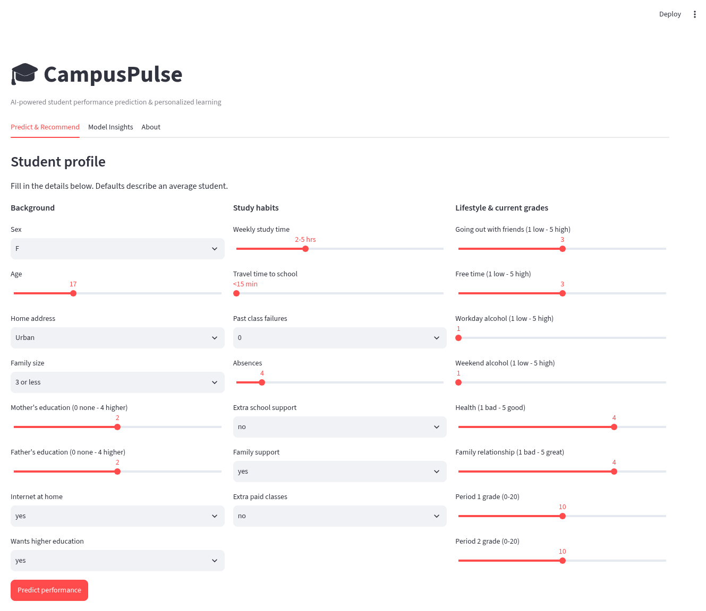
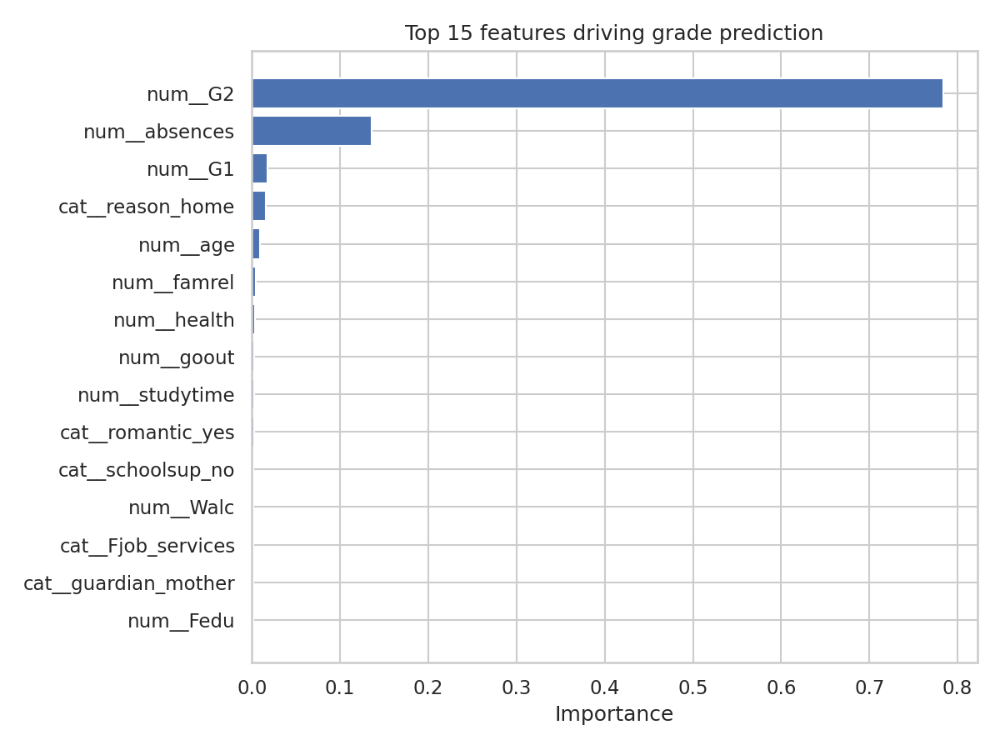
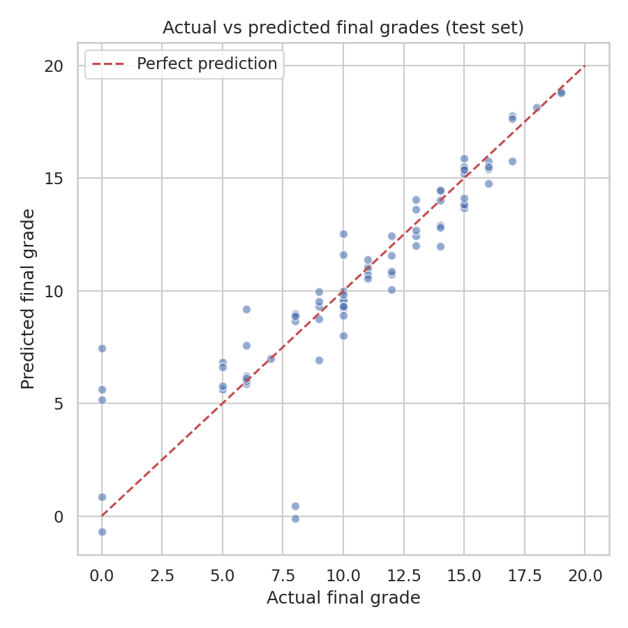
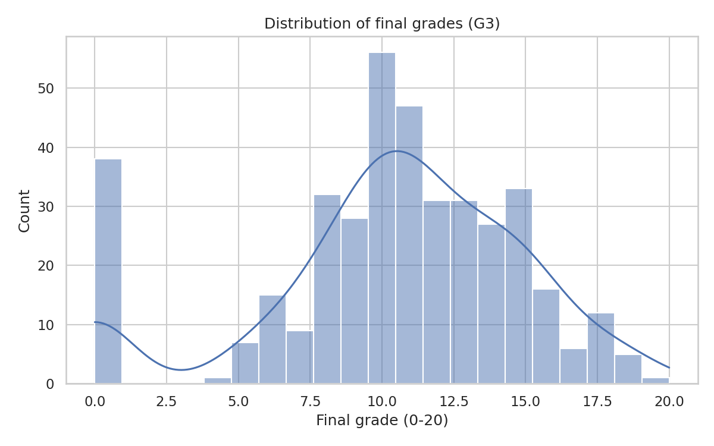
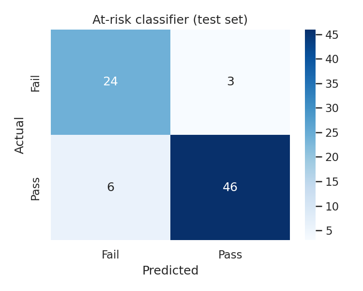

# 🎓 CampusPulse

**AI-Powered Student Performance Prediction & Personalized Learning System**

CampusPulse predicts a student's final grade and their risk of failing, then
turns that prediction into a concrete, personalized learning plan. It combines
two machine learning models with a transparent rule-based recommendation
engine, wrapped in an interactive Streamlit app.

## Why this project?

Schools usually react *after* a student fails. CampusPulse shows how machine
learning can flag at-risk students **during** the term and suggest specific
actions - more study time in the right place, attendance fixes, tutoring,
exam practice - instead of a generic "work harder".

## Demo



## Features

- **Grade prediction** - predicts the final grade (0-20 scale) with a mean
  absolute error of ~1.2 grades
- **At-risk classification** - flags students likely to fail with ~89% accuracy
- **Early-warning mode** - metrics are also reported *without* midterm grades,
  showing how much signal exists before any exam
- **Personalized recommendations** - rule-based learning plans mapped to free
  resources (Khan Academy, NPTEL, Coursera)
- **Interactive demo** - Streamlit app with live prediction and explanations
- **Explainability** - feature importance, actual-vs-predicted and confusion
  matrix plots generated on every training run

## Results

| Model | Task | Metric | Score |
|---|---|---|---|
| Gradient Boosting Regressor | Predict final grade (0-20) | MAE / R² | 1.16 / 0.81 |
| Gradient Boosting Classifier | Pass vs fail | Accuracy / F1 | 0.89 / 0.91 |
| Regressor (no midterm grades) | Early warning | R² | 0.25 |

Full metrics in [`reports/metrics.json`](reports/metrics.json).

| Feature importance | Actual vs predicted |
|---|---|
|  |  |

| Grade distribution | At-risk classifier |
|---|---|
|  |  |

## How it works

```
student record (33 features)
        │
        ▼
┌─────────────────────┐
│  Preprocessing      │   OneHotEncoder (categorical) + StandardScaler (numeric)
│  (ColumnTransformer)│
└─────────┬───────────┘
          │
   ┌──────┴───────┐
   ▼              ▼
┌─────────┐  ┌──────────┐
│ Grade   │  │ At-risk  │   Gradient Boosting (scikit-learn Pipelines)
│regressor│  │classifier│
└────┬────┘  └────┬─────┘
     │            │
     └──────┬─────┘
            ▼
┌─────────────────────────┐
│ Recommendation engine   │   Transparent rules over profile + prediction
│ (src/recommender.py)    │
└─────────┬───────────────┘
          ▼
   Personalized learning plan + curated resources
```

## Project structure

```
campuspulse/
├── app/
│   └── streamlit_app.py          # interactive demo (3 tabs)
├── data/
│   ├── raw/student-mat.csv       # training data (UCI, CC BY 4.0)
│   └── README.md                 # dataset details + citation
├── models/                       # trained model files (joblib)
├── notebooks/
│   └── 01_eda_and_model_selection.ipynb   # EDA + model comparison
├── reports/
│   ├── metrics.json              # all evaluation metrics
│   └── figures/                  # auto-generated plots
├── scripts/
│   └── download_data.py          # re-fetch raw data from UCI
├── src/
│   ├── data_preprocessing.py     # loading + ColumnTransformer pipeline
│   ├── train_model.py            # training, evaluation, figures
│   ├── predict.py                # load models, predict one student
│   └── recommender.py            # rule-based learning plan generator
├── tests/
│   └── test_pipeline.py          # smoke tests
└── requirements.txt
```

## Getting started

```bash
# 1. Clone and set up
git clone https://github.com/TheMaddy2005/campuspulse.git
cd campuspulse
python -m venv .venv && source .venv/bin/activate   # Windows: .venv\Scripts\activate
pip install -r requirements.txt

# 2. (Optional) retrain the models from scratch
cd src && python train_model.py && cd ..

# 3. Run the app
streamlit run app/streamlit_app.py

# 4. Run the tests
python tests/test_pipeline.py        # or: python -m pytest tests/
```

The trained models and dataset are committed, so **step 2 is optional** - the
app works straight after `pip install`.

## Dataset

[UCI Machine Learning Repository - Student Performance](https://archive.ics.uci.edu/dataset/320/student+performance)
(CC BY 4.0): 395 secondary-school students in Mathematics, collected in
Portugal in 2008. See [`data/README.md`](data/README.md) for the full citation.

## Tech stack

Python · pandas · scikit-learn · Streamlit · matplotlib/seaborn · joblib

## What I learned building this

- **Pipelines prevent leakage**: preprocessing lives inside the scikit-learn
  `Pipeline`, so the exact same transformation runs in training and prediction.
- **Honest metrics matter**: with `G1`/`G2` included the R² is 0.81; without
  them it drops to 0.25. Reporting both shows what the model can and cannot do.
- **Prediction is only half the product**: the recommendation engine is plain,
  readable rules - easy to audit, easy to explain, and every suggestion traces
  back to a specific feature of the student's profile.

## Roadmap

- [ ] Add the Portuguese-language dataset (649 more students)
- [ ] SHAP-based per-prediction explanations
- [ ] Teacher dashboard for a whole class (batch predictions)

## Disclaimer

Educational project. Predictions are statistical estimates from a small 2008
dataset - a starting point for a conversation, never a judgment of a student.

## License

MIT © 2026 Mandakini Manjal
